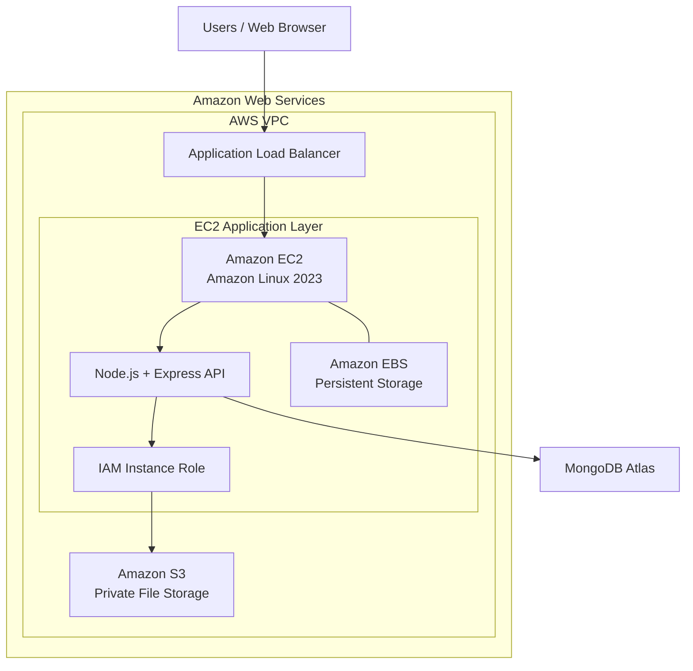
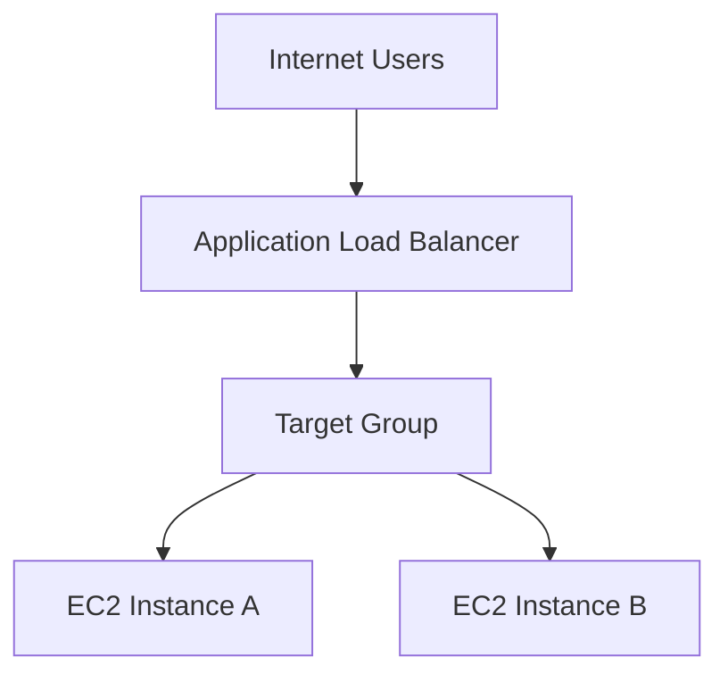
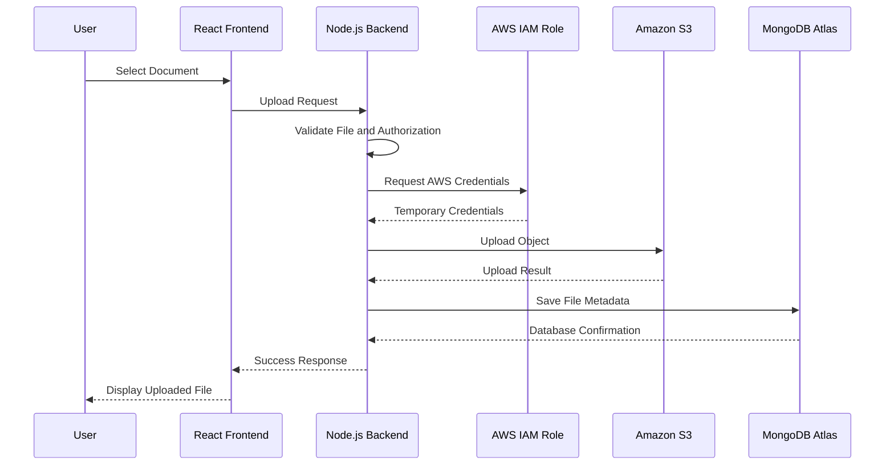

# ☁️ SecureShare – AWS Cloud Deployment Project

### A Secure MERN-Based File Sharing Platform Deployed on Amazon Web Services


---

## 📌 1. Project Overview

**SecureShare** is a MERN-based cloud-enabled file-sharing platform designed to provide users with a secure and convenient way to upload, manage, download, and share documents.

The primary objective of this project is to integrate a full-stack web application with AWS cloud infrastructure and understand how different AWS services work together to provide scalable, reliable, and secure application hosting.

The application uses MongoDB Atlas for database management and Amazon S3 for file object storage. The backend application runs on an Amazon EC2 instance, while IAM controls access to AWS resources.

The infrastructure also incorporates EBS for persistent block storage, VPC for network isolation, and Elastic Load Balancing (ELB) for distributing incoming application traffic.

### 🎯 Project Objectives

- Deploy a MERN-based application on AWS.
- Host the backend application on Amazon EC2.
- Integrate Amazon S3 for cloud-based file storage.
- Configure IAM roles and policies for secure AWS access.
- Understand EBS volumes and persistent storage.
- Configure VPC networking, subnets, and security groups.
- Integrate Elastic Load Balancing for application traffic distribution.
- Establish secure communication between application components.
- Perform deployment testing and troubleshoot cloud infrastructure.

---

## 🛠️ 2. Technology Stack

| Technology | Purpose |
|---|---|
| React.js | Frontend development |
| Node.js | Backend runtime |
| Express.js | REST API development |
| MongoDB Atlas | Database management |
| Amazon EC2 | Application hosting |
| Amazon S3 | File and document storage |
| AWS IAM | Identity and access management |
| Amazon EBS | Persistent block storage |
| Amazon VPC | Network isolation |
| Elastic Load Balancer | Traffic distribution |
| Kali Linux | Deployment workstation |
| Amazon Linux 2023 | EC2 operating system |
| Git & GitHub | Version control and source code management |
| AWS SDK for JavaScript | Backend integration with S3 |

---

## 🏗️ 3. AWS Architecture

The project follows a cloud-based architecture in which the frontend communicates with a backend application hosted on EC2.

The backend interacts with MongoDB Atlas for database operations and Amazon S3 for file storage.

### Architecture Diagram



### Architecture Explanation

1. Users access the SecureShare application through a web browser.
2. Incoming requests reach the application through the Elastic Load Balancer.
3. EC2 hosts the application backend using Amazon Linux 2023.
4. Node.js and Express process application requests.
5. IAM provides authorized access to AWS resources.
6. Amazon S3 stores uploaded documents and files.
7. MongoDB Atlas stores user information and file metadata.
8. EBS provides persistent block storage to the EC2 instance.
9. VPC provides the network environment for AWS resources.

**Note:** The diagram represents the intended integrated architecture. Confirm the ALB, subnet, and resource configurations in your AWS account before claiming that every component is deployed and operational.

---

# ☁️ 4. AWS Services Used in This Project

## 4.1 Amazon EC2 – Elastic Compute Cloud

**Purpose: Application Hosting**

Amazon EC2 provides virtual servers in the AWS cloud.

In this project, EC2 is used to host the SecureShare backend application and its Node.js runtime.

### EC2 Configuration

| Configuration | Value |
|---|---|
| Service | Amazon EC2 |
| Region | eu-north-1 |
| Operating System | Amazon Linux 2023 |
| Instance Type | t3.micro (starter configuration) |
| Connection | SSH |
| Application Runtime | Node.js |
| Backend Framework | Express.js |

### Step 1: Launch EC2 Instance

1. Open the AWS Management Console.
2. Navigate to EC2.
3. Select Launch Instance.
4. Enter the instance name: `SecureShare-Server`.
5. Select Amazon Linux 2023.
6. Select the t3.micro instance type.
7. Create or select an SSH key pair.
8. Configure the VPC and security group.
9. Configure the EBS root volume.
10. Launch the instance.

### Step 2: Connect from Kali Linux

The deployment workstation used for administration is Kali Linux running inside VMware.

First, configure the private key permissions:

```bash
chmod 400 ~/Downloads/SecureShare-Key.pem
```

Connect to EC2:

```bash
ssh -i ~/Downloads/SecureShare-Key.pem ec2-user@YOUR_EC2_PUBLIC_IP
```

### Step 3: Update the EC2 Server

```bash
sudo dnf update -y
```

Install Git:

```bash
sudo dnf install git -y
```

Install Node.js:

```bash
sudo dnf install nodejs20 -y
```

Verify installations:

```bash
node --version
npm --version
git --version
```

### Step 4: Clone the GitHub Repository

```bash
cd ~
git clone https://github.com/xss-pushpensh/AWS-project.git
```

Navigate into the project:

```bash
cd AWS-project
```

### Step 5: Install Backend Dependencies

```bash
cd server
npm install
```

### Step 6: Install Frontend Dependencies

```bash
cd ../client
npm install
```

Build the frontend if the project provides a build script:

```bash
npm run build
```

### EC2 Role in This Project

- Runs the backend application.
- Processes user authentication and API requests.
- Communicates with MongoDB Atlas.
- Uploads and retrieves files from Amazon S3.
- Uses IAM permissions to access AWS resources.

---

## 4.2 Amazon S3 – Simple Storage Service

**Purpose: Cloud File Storage**

Amazon S3 is an object storage service used to store uploaded documents and files independently of the EC2 server's local filesystem.

In SecureShare, S3 is integrated with the Node.js backend using the AWS SDK for JavaScript.

### S3 Configuration

| Configuration | Description |
|---|---|
| Service | Amazon S3 |
| Region | eu-north-1 |
| Storage Type | Object Storage |
| Access | Private |
| Integration | AWS SDK for JavaScript |
| Authentication | EC2 IAM Role |

### Step 1: Create an S3 Bucket

1. Open the AWS Management Console.
2. Navigate to Amazon S3.
3. Select Create Bucket.
4. Enter a globally unique bucket name.
5. Select the region `eu-north-1`.
6. Keep Block Public Access enabled.
7. Enable encryption.
8. Create the bucket.

### Step 2: Install AWS SDK

Navigate to the backend directory:

```bash
cd ~/AWS-project/server
```

Install the S3 SDK:

```bash
npm install @aws-sdk/client-s3
```

### Step 3: Configure the S3 Client

Create an S3 configuration file:

```javascript
const { S3Client } = require("@aws-sdk/client-s3");

const s3 = new S3Client({
    region: process.env.AWS_REGION || "eu-north-1"
});

module.exports = s3;
```

### Step 4: Configure Environment Variables

Create the backend environment file:

```bash
nano .env
```

Add the following configuration:

```env
PORT=5000
NODE_ENV=production

MONGO_URI=YOUR_MONGODB_ATLAS_CONNECTION_STRING
JWT_SECRET=YOUR_LONG_RANDOM_SECRET

AWS_REGION=eu-north-1
S3_BUCKET=YOUR_S3_BUCKET_NAME
```

Save the file.

Protect the environment file:

```bash
chmod 600 .env
```

Never upload `.env` to GitHub.

### Step 5: S3 Upload Workflow

The file upload process follows these steps:

1. User selects a document from the frontend.
2. Frontend sends the file to the backend API.
3. Express receives and validates the uploaded file.
4. Backend communicates with Amazon S3 using AWS SDK.
5. S3 stores the uploaded object.
6. MongoDB stores the associated file metadata and S3 object key.
7. Backend returns the operation result to the frontend.

### S3 Benefits

- Scalable object storage.
- Durable file storage.
- Separation of application compute and file storage.
- Integration with IAM permissions.
- Encryption and access-control features.
- Reduced dependency on EC2 local disk capacity.

---

## 4.3 AWS IAM – Identity and Access Management

**Purpose: Secure AWS Resource Access**

IAM manages permissions and controls which AWS resources an identity can access.

In this project, IAM is used to authorize the EC2 backend to communicate with Amazon S3 without storing permanent AWS access keys inside the application.

### IAM Components

| Component | Name |
|---|---|
| IAM Role | SecureShare-EC2-Role |
| IAM Policy | SecureShare-S3-Access |
| Attached Service | Amazon EC2 |
| Required Resource | Project S3 Bucket |

### Step 1: Create IAM Policy

Navigate to:

AWS Console → IAM → Policies → Create Policy.

Choose JSON and configure a policy similar to the following:

```json
{
  "Version": "2012-10-17",
  "Statement": [
    {
      "Effect": "Allow",
      "Action": [
        "s3:ListBucket",
        "s3:GetBucketLocation"
      ],
      "Resource": "arn:aws:s3:::YOUR_BUCKET_NAME"
    },
    {
      "Effect": "Allow",
      "Action": [
        "s3:PutObject",
        "s3:GetObject",
        "s3:DeleteObject"
      ],
      "Resource": "arn:aws:s3:::YOUR_BUCKET_NAME/*"
    }
  ]
}
```

Replace `YOUR_BUCKET_NAME` with your actual bucket name.

Save the policy as:

`SecureShare-S3-Access`

### Step 2: Create IAM Role

1. Navigate to IAM → Roles.
2. Select Create Role.
3. Choose AWS Service.
4. Select EC2.
5. Attach the `SecureShare-S3-Access` policy.
6. Name the role `SecureShare-EC2-Role`.
7. Create the role.

### Step 3: Attach Role to EC2

1. Open EC2.
2. Select your instance.
3. Navigate to Actions.
4. Select Security.
5. Select Modify IAM Role.
6. Attach `SecureShare-EC2-Role`.

### Step 4: Verify IAM Access

Connect to EC2 and run:

```bash
aws sts get-caller-identity
```

Check bucket access:

```bash
aws s3 ls s3://YOUR_BUCKET_NAME/
```

The AWS CLI must be installed if you want to use these commands.

### Why IAM Is Important

- Prevents hardcoding AWS credentials.
- Provides temporary credentials to EC2.
- Implements least-privilege access.
- Controls access to S3 resources.
- Improves cloud security.

---

## 4.4 Amazon EBS – Elastic Block Store

**Purpose: Persistent Block Storage**

Amazon EBS provides persistent block-level storage volumes for EC2 instances.

In this project, EBS is used to provide disk storage for the EC2 operating system, application files, packages, logs, and other required data.

### EBS Configuration

| Configuration | Description |
|---|---|
| Service | Amazon EBS |
| Volume Type | General Purpose SSD (gp3) |
| Attachment | EC2 Instance |
| Storage Purpose | Persistent Block Storage |
| Encryption | Recommended |

### Step 1: Create EBS Volume

1. Open EC2.
2. Navigate to Elastic Block Store → Volumes.
3. Select Create Volume.
4. Choose gp3.
5. Specify the required storage capacity.
6. Select the same Availability Zone as the EC2 instance.
7. Enable encryption.
8. Create the volume.

### Step 2: Attach Volume

1. Select the newly created volume.
2. Choose Actions → Attach Volume.
3. Select the EC2 instance.
4. Confirm attachment.

### Step 3: Verify Storage on Linux

Connect to EC2 and run:

```bash
lsblk
```

Check available storage:

```bash
df -h
```

Check mounted filesystems:

```bash
findmnt
```

### Important EBS Concepts

- EBS volumes provide persistent block storage.
- Volumes are associated with an Availability Zone.
- EBS volumes can be attached to compatible EC2 instances.
- Snapshots can be used for backup and recovery.
- Encryption helps protect stored data.

### Difference Between EBS and S3

| EBS | S3 |
|---|---|
| Block storage | Object storage |
| Attached to EC2 | Accessed through AWS APIs |
| Used for instance disks | Used for uploaded files |
| Filesystem-based usage | Bucket and object-based usage |
| Volume-level management | Object-level management |

---

## 4.5 Amazon VPC – Virtual Private Cloud

**Purpose: Network Isolation and Infrastructure Connectivity**

Amazon VPC provides a logically isolated network environment for AWS resources.

It allows configuration of IP address ranges, subnets, route tables, Internet Gateways, and security groups.

### VPC Configuration

The following CIDR layout represents the proposed project network design.

| Component | Configuration |
|---|---|
| VPC | SecureShare-VPC |
| IPv4 CIDR | 10.0.0.0/16 |
| Public Subnet A | 10.0.1.0/24 |
| Public Subnet B | 10.0.2.0/24 |
| Internet Gateway | Attached to VPC |
| Route Table | Public Route Table |
| Security | Security Groups |

### Step 1: Create VPC

1. Open the AWS VPC Console.
2. Select Create VPC.
3. Enter `SecureShare-VPC`.
4. Configure IPv4 CIDR as `10.0.0.0/16`.
5. Create the VPC.

### Step 2: Create Subnets

Create two subnets:

**Subnet A**

```text
Name: SecureShare-Public-A
CIDR: 10.0.1.0/24
```

**Subnet B**

```text
Name: SecureShare-Public-B
CIDR: 10.0.2.0/24
```

For an Application Load Balancer, select subnets in different Availability Zones.

### Step 3: Create Internet Gateway

1. Navigate to Internet Gateways.
2. Select Create Internet Gateway.
3. Name it `SecureShare-IGW`.
4. Attach it to SecureShare-VPC.

### Step 4: Configure Route Table

Create a public route table.

Add the following routes:

| Destination | Target |
|---|---|
| 10.0.0.0/16 | Local |
| 0.0.0.0/0 | Internet Gateway |

Associate the route table with the public subnets.

### Step 5: Configure Security Groups

Recommended security-group structure:

**ALB Security Group**

| Type | Port | Source |
|---|---|---|
| HTTPS | 443 | 0.0.0.0/0 |
| HTTP | 80 | 0.0.0.0/0 (optional redirect) |

**EC2 Security Group**

| Type | Port | Source |
|---|---|---|
| SSH | 22 | Trusted administrator IP |
| Application | 5000 | ALB Security Group |

Only allow the ports actually required by the application configuration.

### VPC Benefits

- Network isolation.
- Custom IP address ranges.
- Subnet-level organization.
- Controlled inbound and outbound traffic.
- Security group-based access control.
- Integration with EC2 and Elastic Load Balancing.

**Production improvement:** For a stronger architecture, place EC2 application instances in private subnets and use controlled outbound connectivity such as NAT or appropriate VPC endpoints.

---

## 4.6 Elastic Load Balancing (ELB)

**Purpose: Application Traffic Distribution**

Elastic Load Balancing automatically distributes incoming application traffic across registered targets.

For SecureShare, an Application Load Balancer (ALB) is the appropriate choice because it supports HTTP and HTTPS traffic.

### ALB Architecture



### Step 1: Create Application Load Balancer

1. Open EC2 Console.
2. Navigate to Load Balancers.
3. Select Create Load Balancer.
4. Choose Application Load Balancer.
5. Enter `SecureShare-ALB`.
6. Select Internet-facing.
7. Select IPv4.
8. Choose the project VPC.
9. Select at least two public subnets in different Availability Zones.
10. Attach the ALB security group.

### Step 2: Create Target Group

1. Navigate to Target Groups.
2. Select Create Target Group.
3. Select Instances as the target type.
4. Choose HTTP.
5. Configure the application target port.
6. Configure the health-check path.
7. Register the EC2 instance.

For example, use port `5000` if the Express application listens directly on that port.

### Step 3: Configure Listener

Configure the listener:

```text
Protocol: HTTPS
Port: 443
Target Group: SecureShare-Target-Group
```

An ACM certificate for your domain is required for HTTPS.

### Step 4: Verify Target Health

Navigate to:

EC2 → Target Groups → Targets.

Verify that the registered targets report healthy.

### Benefits of ELB

- Distributes incoming requests.
- Performs health checks.
- Supports application availability.
- Supports HTTPS termination.
- Enables horizontal scaling when additional EC2 targets are registered.

**Important:** Actual load distribution across multiple EC2 instances requires multiple registered healthy targets. An ALB with only one target does not provide instance-level redundancy.

---

# 🚀 5. Complete Application Deployment Workflow

The following workflow summarizes the application deployment on EC2.

### Step 1: Connect to EC2

```bash
ssh -i SecureShare-Key.pem ec2-user@YOUR_EC2_PUBLIC_IP
```

### Step 2: Update the System

```bash
sudo dnf update -y
```

### Step 3: Clone Repository

```bash
git clone https://github.com/xss-pushpensh/AWS-project.git
cd AWS-project
```

### Step 4: Install Backend Dependencies

```bash
cd server
npm install
```

### Step 5: Install S3 SDK

```bash
npm install @aws-sdk/client-s3
```

### Step 6: Configure Environment

```bash
nano .env
```

Configure the MongoDB connection, JWT secret, AWS region and bucket name.

### Step 7: Install Frontend Dependencies

```bash
cd ../client
npm install
```

### Step 8: Build Frontend

```bash
npm run build
```

### Step 9: Start Backend

```bash
cd ~/AWS-project/server
node server.js
```

This command is suitable for an initial deployment test. For production, configure a persistent process manager such as systemd or PM2.

### Step 10: Verify Application

Check listening ports:

```bash
sudo ss -tulpn
```

Test the backend locally:

```bash
curl -i http://127.0.0.1:5000/
```

Use the actual application port and a valid API route if the root route is not defined.

---

# 🔄 6. Application Data Flow

### File Upload Process



### File Download Process

1. User requests a file.
2. Backend verifies the user's authentication and authorization.
3. Backend retrieves the file reference from MongoDB.
4. Backend accesses the S3 object.
5. The file is returned through the application's authorized download flow.

---

# 🔐 7. Security Implementation

Security is an important part of the SecureShare project.

The following practices are used or recommended in the deployment architecture:

### AWS Security

- IAM roles instead of permanent AWS credentials.
- Least-privilege IAM policies.
- Private S3 bucket configuration.
- S3 Block Public Access.
- Encrypted EBS volumes.
- Restricted EC2 security groups.
- Controlled SSH access.
- VPC-based network isolation.

### Application Security

- Authentication using JWT.
- User authorization for file operations.
- File type validation.
- File size restrictions.
- Secure environment variable management.
- Backend validation of user requests.

### Important Security Practices

Never upload the following to GitHub:

```text
.env
AWS_ACCESS_KEY_ID
AWS_SECRET_ACCESS_KEY
JWT_SECRET
MongoDB database passwords
SSH private keys
```

Use `.gitignore` to exclude sensitive files.

---

# 🧪 8. Testing and Verification

The following tests should be performed to validate the deployment.

| Test | Verification | Expected Result |
|---|---|---|
| EC2 | SSH connection | Successful connection |
| Node.js | node --version | Runtime available |
| Git | git --version | Git installed |
| MongoDB | Application DB connection | Successful connection |
| S3 | Upload a document | Object stored in S3 |
| IAM | get-caller-identity | EC2 role identity returned |
| EBS | lsblk | Attached block device visible |
| VPC | Check subnet and routes | Correct network connectivity |
| ELB | Target group health | Healthy registered targets |
| Application | Open application | Application responds correctly |

### Useful Troubleshooting Commands

Check Node.js:

```bash
node --version
npm --version
```

Check running processes:

```bash
ps aux | grep node
```

Check network ports:

```bash
sudo ss -tulpn
```

Check storage:

```bash
lsblk
df -h
```

Check application logs if using a systemd service:

```bash
sudo journalctl -u secureshare -f
```

Check S3 configuration:

```bash
grep -E '^(AWS_REGION|S3_BUCKET)=' .env
```

Verify AWS identity:

```bash
aws sts get-caller-identity
```

---

# 📂 9. Project Directory Structure

```text
AWS-project/
│
├── client/
│   ├── public/
│   ├── src/
│   ├── package.json
│   └── ...
│
├── server/
│   ├── config/
│   ├── controllers/
│   ├── models/
│   ├── routes/
│   ├── middleware/
│   ├── package.json
│   ├── server.js
│   └── ...
│
├── .gitignore
│
└── README.md
```

The exact internal folder structure may evolve as the application is developed.

---

# 📊 10. AWS Services Summary

| AWS Service | Role in SecureShare |
|---|---|
| Amazon EC2 | Hosts the backend application |
| Amazon S3 | Stores uploaded documents and files |
| AWS IAM | Controls AWS resource permissions |
| Amazon EBS | Provides persistent block storage |
| Amazon VPC | Provides network isolation |
| Elastic Load Balancing | Distributes application traffic |

### Why These Services Together?

Each service performs a separate responsibility.

- EC2 handles application execution.
- S3 handles scalable object storage.
- IAM handles authorization.
- EBS handles persistent disk storage.
- VPC handles networking.
- ELB handles traffic distribution.

Together, they form a cloud infrastructure suitable for hosting and extending a full-stack web application.

---

# 📈 11. Future Improvements

The project can be extended with the following improvements:

- Auto Scaling Groups for EC2.
- Multi-AZ application deployment.
- Private subnets for backend instances.
- AWS Certificate Manager for HTTPS.
- CloudWatch monitoring and alarms.
- AWS Secrets Manager for application secrets.
- S3 lifecycle management.
- S3 versioning and backup strategies.
- CI/CD automation using GitHub Actions.
- Infrastructure as Code using Terraform.
- Improved application logging and monitoring.

---

# 🎓 12. Learning Outcomes

Through this project, I gained practical exposure to:

1. Deploying a full-stack MERN application on AWS.
2. Connecting to remote Linux servers through SSH.
3. Managing Amazon Linux 2023.
4. Installing and configuring Node.js applications.
5. Integrating Amazon S3 with a Node.js backend.
6. Understanding IAM roles and permission policies.
7. Working with EBS block storage.
8. Understanding VPC networking and security groups.
9. Learning Application Load Balancer configuration.
10. Troubleshooting cloud deployment issues.

---

# 👨‍💻 13. Author

**Pushpensh**

Computer Science Student | Cloud Computing | Cybersecurity | AWS

GitHub: [@xss-pushpensh](https://github.com/xss-pushpensh)

Project Repository:

[SecureShare – AWS-project](https://github.com/xss-pushpensh/AWS-project)

---

# 📚 14. Official Documentation

- [Amazon EC2 Documentation](https://docs.aws.amazon.com/ec2/)
- [Amazon S3 Documentation](https://docs.aws.amazon.com/s3/)
- [AWS IAM Documentation](https://docs.aws.amazon.com/iam/)
- [Amazon EBS Documentation](https://docs.aws.amazon.com/ebs/)
- [Amazon VPC Documentation](https://docs.aws.amazon.com/vpc/)
- [Elastic Load Balancing Documentation](https://docs.aws.amazon.com/elasticloadbalancing/)
- [AWS SDK for JavaScript](https://docs.aws.amazon.com/sdk-for-javascript/)

---

## ⭐ Conclusion

SecureShare demonstrates the integration of a MERN-based web application with Amazon Web Services.

By combining EC2, S3, IAM, EBS, VPC and Elastic Load Balancing, the project explores the major building blocks of cloud infrastructure, including application hosting, object storage, identity management, persistent storage, networking and traffic distribution.

The project helped develop practical knowledge of cloud deployment, Linux server administration, AWS service integration and cloud security fundamentals.

**Built with React, Node.js, MongoDB Atlas and Amazon Web Services.**

---
